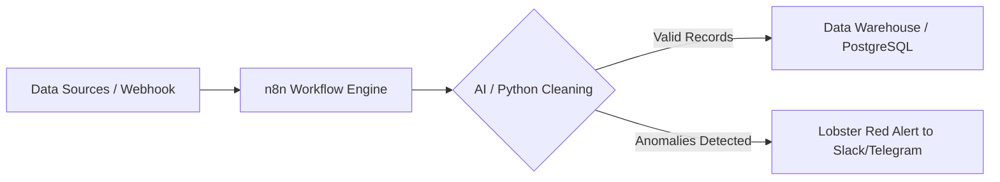

# TÀI LIỆU ĐẶC TẢ KỸ THUẬT & HƯỚNG DẪN TRIỂN KHAI VIBE CODING
## DỰ ÁN: HIGH-PERFORMANCE TECH PM PORTFOLIO & CMS
**Định vị:** Technical Project Manager (Chuyên môn AI, Data & Systems)  
**Kiến trúc:** Next.js 15 (App Router) + Supabase + Vercel + Resend + Codex Plus  

---

### PHẦN 1: BẢNG MÀU THƯƠNG HIỆU & HỆ THỐNG THỊ GIÁC (DESIGN TOKENS)

Dựa trên bảng màu nhận diện thương hiệu được cung cấp, hệ thống màu sắc được chuẩn hóa vào giao diện số với triết lý **Modern High-Tech Dark / Deep Ocean**:

```
+------------------------------------------------------------------------------------------------+
| TÊN MÀU TRÊN BRAND       | MÃ HEX   | THÔNG SỐ RGB   | CMYK                 | VAI TRÒ TRONG GIAO DIỆN WEB                |
+--------------------------+----------+----------------+----------------------+--------------------------------------------+
| Steel Marine             | #0A0A3A  | R10 G10 B58    | C100 M97 Y40 K53     | Nền chính (Background Dark), Surface Card  |
| Deep Sea Blue            | #05308C  | R5 G48 B140    | C100 M90 Y13 K3      | Brand Primary, Glow Halo, Border Beam, Nav |
| Lobster Red              | #AD1F23  | R173 G31 B35   | C17 M100 Y100 K9     | Highlight Accent, Status Badge, High-CTA   |
| Claw Cream               | #FEFDF8  | R254 G253 B248 | C0 M0 Y2 K0          | Text chính (High Contrast), Surface Light  |
+------------------------------------------------------------------------------------------------+
```

#### 1.1. Cấu hình Tailwind CSS (`tailwind.config.ts`)
```typescript
import type { Config } from "tailwindcss";

const config: Config = {
  darkMode: ["class"],
  content: [
    "./pages/**/*.{js,ts,jsx,tsx,mdx}",
    "./components/**/*.{js,ts,jsx,tsx,mdx}",
    "./app/**/*.{js,ts,jsx,tsx,mdx}",
  ],
  theme: {
    extend: {
      colors: {
        steel: {
          marine: "#0A0A3A", // Dark base background
          surface: "#10104A", // Elevated card surface
          border: "#1C1C66", // Subtle borders
        },
        deepsea: {
          DEFAULT: "#05308C", // Primary action
          hover: "#0741BD",
          glow: "rgba(5, 48, 140, 0.45)",
        },
        lobster: {
          DEFAULT: "#AD1F23", // Accent highlight / High-priority
          hover: "#CF252A",
          subtle: "rgba(173, 31, 35, 0.15)",
        },
        cream: {
          DEFAULT: "#FEFDF8", // Crisp contrast text
          muted: "#D1D0CA",  // Secondary body text
          dark: "#1E1E24",   // Text on light components
        },
      },
      fontFamily: {
        sans: ["var(--font-jakarta)", "sans-serif"],
        mono: ["var(--font-jetbrains-mono)", "monospace"],
      },
      boxShadow: {
        "glow-blue": "0 0 35px -5px rgba(5, 48, 140, 0.5)",
        "glow-red": "0 0 25px -5px rgba(173, 31, 35, 0.4)",
        "glass-elevated": "0 8px 32px 0 rgba(10, 10, 58, 0.37)",
      },
      backdropBlur: {
        xs: "2px",
      },
    },
  },
  plugins: [require("@tailwindcss/typography"), require("tailwindcss-animate")],
};
export default config;
```

---

### PHẦN 2: TOÀN BỘ TECH STACK, THƯ VIỆN & CÔNG CỤ (FULL ARSENAL)

```
[ FRONTEND LAYER ]
├── Framework: Next.js 15 (App Router, Server Components & Server Actions)
├── Styling: Tailwind CSS v3/v4 + Tailwind Animate + PostCSS
├── Icons: Lucide React (Bộ icon tối giản, kỹ thuật)
├── Motion: Framer Motion v11 (Animation vật lý mượt mà, thời lượng 0.2s - 0.35s)
├── Component Repos:
│   ├── shadcn/ui (Nền tảng Button, Dialog, Form, Tabs, Dropdown)
│   ├── Aceternity UI (Background Beams, Spotlight, Hover Border Gradient)
│   └── Magic UI (Bento Grid, Dot Pattern, Marquee dải logo)
└── Rich Media & Charts:
    ├── Recharts (Biểu đồ số liệu định lượng, độ chính xác mô hình AI, Burndown Chart)
    ├── Mermaid.js (Render sơ đồ luồng dữ liệu kiến trúc hệ thống trực tiếp từ Markdown)
    └── React-Markdown + Rehype-Highlight + Remark-Gfm (Trình đọc nội dung chi tiết)

[ BACKEND & DATA LAYER ]
├── Database: Supabase PostgreSQL
├── Authentication: Supabase Auth (Dành riêng cho quyền truy cập `/admin`)
├── File & Media Storage: Supabase Storage (Bucket: `portfolio-media`)
├── Data Access: @supabase/ssr (Server Client & Client Component access)
└── Email Dispatcher: Resend API (Gửi email thông báo tức thì khi có người điền form)

[ HOSTING & DEVOPS ]
├── Deployment: Vercel (Edge Network, CI/CD tự động từ GitHub)
├── Analytics: Vercel Web Analytics & Speed Insights
└── Security: Cloudflare Turnstile (Chống bot spam form liên hệ)
```

---

### PHẦN 3: KIẾN TRÚC CƠ SỞ DỮ LIỆU SUPABASE (DATABASE SCHEMA & RLS)

Chạy đoạn mã SQL sau trực tiếp trên **Supabase SQL Editor** để thiết lập toàn bộ các bảng, chỉ mục và chính sách bảo mật (Row Level Security - RLS):

```sql
-- KÍCH HOẠT EXTENSION UUID
CREATE EXTENSION IF NOT EXISTS "uuid-ossp";

-- 1. BẢNG DỰ ÁN & ĐỒ ÁN (PROJECTS / CASE STUDIES)
CREATE TABLE public.projects (
    id UUID PRIMARY KEY DEFAULT uuid_generate_v4(),
    slug VARCHAR(255) UNIQUE NOT NULL,
    title VARCHAR(255) NOT NULL,
    tagline TEXT NOT NULL,
    role VARCHAR(100) NOT NULL, -- e.g. "Tech PM & Lead", "Scrum Master"
    timeline VARCHAR(100) NOT NULL, -- e.g. "3 Months (2025)"
    team_size INT DEFAULT 1,
    methodology VARCHAR(100) DEFAULT 'Agile / Scrum',
    domain_category VARCHAR(100) NOT NULL, -- 'AI & Computer Vision', 'Data & Automation', 'Enterprise Systems'
    pm_competencies TEXT[] DEFAULT '{}', -- ARRAY['Agile Delivery', 'Risk Management', 'System Architecture']
    tech_stack TEXT[] DEFAULT '{}', -- ARRAY['Python', 'n8n', 'OpenCV', 'PostgreSQL', 'Jira']
    executive_summary TEXT NOT NULL,
    problem_statement TEXT NOT NULL,
    architecture_markdown TEXT, -- Chứa mã Mermaid.js hoặc mô tả luồng
    metrics_json JSONB DEFAULT '[]'::jsonb, -- Dữ liệu chỉ số đo lường [{label: "Accuracy", value: "93.8%"}]
    risks_json JSONB DEFAULT '[]'::jsonb, -- Nhật ký rủi ro [{risk: "...", severity: "High", mitigation: "..."}]
    cover_image_url TEXT,
    gallery_image_urls TEXT[] DEFAULT '{}',
    featured_order INT DEFAULT 0, -- 1, 2, 3 hiển thị trên Homepage (0 = không featured)
    is_published BOOLEAN DEFAULT false,
    created_at TIMESTAMP WITH TIME ZONE DEFAULT NOW(),
    updated_at TIMESTAMP WITH TIME ZONE DEFAULT NOW()
);

-- 2. BẢNG BÀI VIẾT & GÓC NHÌN QUẢN TRỊ (ARTICLES)
CREATE TABLE public.articles (
    id UUID PRIMARY KEY DEFAULT uuid_generate_v4(),
    slug VARCHAR(255) UNIQUE NOT NULL,
    title VARCHAR(255) NOT NULL,
    summary TEXT NOT NULL,
    content_mdx TEXT NOT NULL,
    category VARCHAR(100) NOT NULL, -- 'Tech PM Handbook', 'Automation & n8n', 'Data & AI'
    cover_image_url TEXT,
    read_time_minutes INT DEFAULT 5,
    is_published BOOLEAN DEFAULT false,
    published_at TIMESTAMP WITH TIME ZONE,
    created_at TIMESTAMP WITH TIME ZONE DEFAULT NOW(),
    updated_at TIMESTAMP WITH TIME ZONE DEFAULT NOW()
);

-- 3. BẢNG LIÊN HỆ TỪ NHÀ TUYỂN DỤNG (CONTACT INQUIRIES)
CREATE TABLE public.contact_inquiries (
    id UUID PRIMARY KEY DEFAULT uuid_generate_v4(),
    sender_name VARCHAR(255) NOT NULL,
    sender_email VARCHAR(255) NOT NULL,
    company VARCHAR(255),
    purpose VARCHAR(100) NOT NULL, -- 'Job Opportunity', 'Consulting Project', 'Speaking/Event', 'Networking'
    message TEXT NOT NULL,
    status VARCHAR(50) DEFAULT 'new', -- 'new', 'contacted', 'archived'
    ip_address VARCHAR(100),
    created_at TIMESTAMP WITH TIME ZONE DEFAULT NOW()
);

-- 4. BẢNG KINH NGHIỆM LÀM VIỆC & HOẠT ĐỘNG (EXPERIENCES)
CREATE TABLE public.experiences (
    id UUID PRIMARY KEY DEFAULT uuid_generate_v4(),
    organization VARCHAR(255) NOT NULL,
    role VARCHAR(255) NOT NULL,
    type VARCHAR(100) NOT NULL, -- 'Corporate Internship', 'Academic Leadership', 'Volunteering'
    start_date DATE NOT NULL,
    end_date DATE, -- NULL nếu hiện tại
    is_current BOOLEAN DEFAULT false,
    bullet_points TEXT[] DEFAULT '{}',
    order_index INT DEFAULT 0
);

-- 5. BẢNG CHỨNG CHỈ & GIẢI THƯỞNG (CREDENTIALS & AWARDS)
CREATE TABLE public.credentials (
    id UUID PRIMARY KEY DEFAULT uuid_generate_v4(),
    title VARCHAR(255) NOT NULL,
    issuer VARCHAR(255) NOT NULL, -- 'PMI', 'Google', 'UEL / Toàn quốc'
    type VARCHAR(50) NOT NULL, -- 'Certification', 'Award'
    issue_date VARCHAR(50) NOT NULL,
    credential_url TEXT, -- Link verify Credly hoặc bằng chứng
    badge_image_url TEXT,
    order_index INT DEFAULT 0
);

-- BẬT CHẾ ĐỘ ROW LEVEL SECURITY (RLS)
ALTER TABLE public.projects ENABLE ROW LEVEL SECURITY;
ALTER TABLE public.articles ENABLE ROW LEVEL SECURITY;
ALTER TABLE public.contact_inquiries ENABLE ROW LEVEL SECURITY;
ALTER TABLE public.experiences ENABLE ROW LEVEL SECURITY;
ALTER TABLE public.credentials ENABLE ROW LEVEL SECURITY;

-- POLICIES: NGƯỜI DÙNG CÔNG KHAI CHỈ ĐƯỢC ĐỌC DỮ LIỆU ĐÃ XUẤT BẢN
CREATE POLICY "Public read published projects" ON public.projects
FOR SELECT USING (is_published = true);

CREATE POLICY "Public read published articles" ON public.articles
FOR SELECT USING (is_published = true);

CREATE POLICY "Public read experiences" ON public.experiences
FOR SELECT USING (true);

CREATE POLICY "Public read credentials" ON public.credentials
FOR SELECT USING (true);

-- POLICIES: CHO PHÉP KHÁCH GỬI FORM LIÊN HỆ
CREATE POLICY "Public can insert contact inquiries" ON public.contact_inquiries
FOR INSERT WITH CHECK (true);

-- POLICIES: CHỈ ADMIN ĐÃ ĐĂNG NHẬP MỚI ĐƯỢC TOÀN QUYỀN THAO TÁC (CRUD)
CREATE POLICY "Admin full access projects" ON public.projects
FOR ALL TO authenticated USING (true) WITH CHECK (true);

CREATE POLICY "Admin full access articles" ON public.articles
FOR ALL TO authenticated USING (true) WITH CHECK (true);

CREATE POLICY "Admin full access inquiries" ON public.contact_inquiries
FOR ALL TO authenticated USING (true) WITH CHECK (true);

CREATE POLICY "Admin full access experiences" ON public.experiences
FOR ALL TO authenticated USING (true) WITH CHECK (true);

CREATE POLICY "Admin full access credentials" ON public.credentials
FOR ALL TO authenticated USING (true) WITH CHECK (true);

-- TẠO STORAGE BUCKET CHO ẢNH & BIỂU ĐỒ
INSERT INTO storage.buckets (id, name, public) 
VALUES ('portfolio-media', 'portfolio-media', true);

CREATE POLICY "Public media access" ON storage.objects
FOR SELECT USING (bucket_id = 'portfolio-media');

CREATE POLICY "Admin upload media" ON storage.objects
FOR INSERT TO authenticated WITH CHECK (bucket_id = 'portfolio-media');
```

---

### PHẦN 4: CẤU TRÚC THƯ MỤC CHUẨN NEXT.JS 15 (APP ROUTER)

```
portfolio-root/
├── app/
│   ├── (public)/                      # Phân vùng hiển thị công khai cho nhà tuyển dụng
│   │   ├── layout.tsx                 # Public Layout: Header, Footer, Analytics
│   │   ├── page.tsx                   # Homepage (Hero, Metrics, Featured Projects, Timeline)
│   │   ├── projects/
│   │   │   ├── page.tsx               # Projects Hub (Bộ lọc đa chiều, Search)
│   │   │   └── [slug]/
│   │   │       └── page.tsx           # Case Study chi tiết (Sơ đồ Mermaid, Bảng rủi ro)
│   │   ├── articles/
│   │   │   ├── page.tsx               # Danh sách bài viết & Insights
│   │   │   └── [slug]/
│   │   │       └── page.tsx           # Trình đọc bài viết MDX
│   │   ├── about/
│   │   │   └── page.tsx               # About Me, Lãnh đạo CLB AI, Chứng chỉ PMI
│   │   ├── resume/
│   │   │   └── page.tsx               # PDF Viewer & Nút tải ATS CV
│   │   └── contact/
│   │       └── page.tsx               # Form liên hệ kết nối Resend API
│   │
│   ├── (admin)/                       # Phân vùng quản trị nội dung bảo mật
│   │   ├── admin/
│   │   │   ├── layout.tsx             # Admin Sidebar, Header, User Menu
│   │   │   ├── login/
│   │   │   │   └── page.tsx           # Form đăng nhập Supabase Auth
│   │   │   ├── dashboard/
│   │   │   │   └── page.tsx           # Thống kê nhanh tin nhắn và dự án
│   │   │   ├── projects/
│   │   │   │   ├── page.tsx           # Bảng quản lý đồ án (Thêm/Sửa/Xóa/Ẩn)
│   │   │   │   └── [id]/page.tsx      # Form biên tập chi tiết Case Study & Upload ảnh
│   │   │   ├── articles/
│   │   │   │   └── page.tsx           # Quản lý bài viết MDX
│   │   │   └── inquiries/
│   │   │       └── page.tsx           # Hộp thư xem tin nhắn từ nhà tuyển dụng
│   │
│   ├── api/
│   │   ├── contact/
│   │   │   └── route.ts               # API Route nhận form & kích hoạt Resend Email
│   │   └── og/
│   │       └── route.tsx              # Dynamic OpenGraph Image generator
│   ├── sitemap.ts                     # Tự động tạo sitemap.xml chuẩn SEO từ DB
│   ├── robots.ts                      # Tự động cấu hình robots.txt
│   └── globals.css                    # Cấu hình biến màu sắc Steel Marine & Claw Cream
│
├── components/
│   ├── ui/                            # Thư viện shadcn (Button, Dialog, Badge, Input)
│   ├── magicui/                       # Magic UI (BentoGrid, BorderBeam, Marquee)
│   ├── aceternity/                    # Aceternity UI (BackgroundBeams, Spotlight)
│   ├── visualizers/
│   │   ├── mermaid-renderer.tsx       # Component render sơ đồ kiến trúc động
│   │   └── project-charts.tsx         # Component render biểu đồ Recharts
│   ├── common/
│   │   ├── navbar.tsx                 # Header kính mờ với hiệu ứng trượt mượt mà
│   │   └── footer.tsx                 # Chân trang với liên kết mạng xã hội
│   └── admin/
│       ├── image-uploader.tsx         # Kéo thả upload ảnh trực tiếp lên Supabase
│       └── metrics-editor.tsx         # Thêm bớt chỉ số đo lường linh hoạt
│
├── lib/
│   ├── supabase/
│   │   ├── client.ts                  # Supabase Client cho trình duyệt
│   │   ├── server.ts                  # Supabase Server Client cho Server Components
│   │   └── middleware.ts              # Bảo vệ route `/admin/*` qua JWT Session
│   ├── email/
│   │   └── resend.ts                  # Khởi tạo Resend SDK & Template Email HTML
│   └── seo/
│       └── json-ld.ts                 # Trình tạo Schema.org (Person, Article, Project)
├── .env.local                         # Biến môi trường Vercel, Supabase, Resend
├── middleware.ts                      # Route guard cho Admin
└── tailwind.config.ts                 # Cấu hình Design Tokens
```

---

### PHẦN 5: ĐẶC TẢ CHI TIẾT TỪNG TÍNH NĂNG ĐẶC BIỆT

#### 5.1. Hệ thống Form Liên hệ & Gửi Email Tức thì (Resend Integration)

##### A. Luồng Xử lý Dữ liệu (Workflow)
1. Người dùng truy cập `/contact` hoặc form chân trang, điền đầy đủ: *Họ tên, Email, Công ty, Mục đích liên hệ, Nội dung*.
2. Nhấn nút **Send Message**:
   * Trình duyệt thực hiện xác thực dữ liệu tại chỗ (Client Validation bằng Zod).
   * Nút bấm chuyển sang trạng thái Loading xoay tròn với icon mờ.
3. Kích hoạt Server Action gọi vào API Route `/api/contact`:
   * **Ghi dữ liệu:** Insert một bản ghi mới vào bảng `contact_inquiries` trên Supabase (status = `'new'`).
   * **Gửi thông báo:** Khởi chạy `resend.emails.send()` gửi một email HTML định dạng đẹp mắt đến địa chỉ email cá nhân bạn đã cấu hình trong biến môi trường `NOTIFICATION_RECEIVER_EMAIL`.
4. Trả về kết quả: Hiển thị Toast thông báo thành công xanh lá (hoặc Lobster Red nếu thất bại) và xóa trắng form.

##### B. Mã Nguồn Xử Lý API (`app/api/contact/route.ts`)
```typescript
import { NextResponse } from "next/server";
import { Resend } from "resend";
import { createServerClient } from "@/lib/supabase/server";

const resend = new Resend(process.env.RESEND_API_KEY);

export async function POST(req: Request) {
  try {
    const body = await req.json();
    const { name, email, company, purpose, message } = body;

    if (!name || !email || !message) {
      return NextResponse.json({ error: "Missing required fields" }, { status: 400 });
    }

    // 1. Lưu vào Supabase Database
    const supabase = await createServerClient();
    const { error: dbError } = await supabase.from("contact_inquiries").insert({
      sender_name: name,
      sender_email: email,
      company: company || "N/A",
      purpose: purpose || "General Inquiry",
      message: message,
    });

    if (dbError) throw dbError;

    // 2. Gửi Email thông báo qua Resend
    await resend.emails.send({
      from: "Portfolio Alert <onboarding@resend.dev>",
      to: process.env.NOTIFICATION_RECEIVER_EMAIL!,
      subject: `[Tech PM Lead] Tin nhắn mới từ ${name} (${company || "Cá nhân"})`,
      html: `
        <div style="font-family: Arial, sans-serif; background-color: #0A0A3A; color: #FEFDF8; padding: 24px; border-radius: 12px;">
          <h2 style="color: #AD1F23; border-bottom: 2px solid #05308C; padding-bottom: 8px;">Thông báo Cơ hội Tuyển dụng / Hợp tác Mới</h2>
          <p><strong>Người gửi:</strong> ${name} &lt;${email}&gt;</p>
          <p><strong>Tổ chức / Doanh nghiệp:</strong> ${company || "Không cung cấp"}</p>
          <p><strong>Mục đích:</strong> <span style="background-color: #05308C; padding: 4px 8px; border-radius: 4px;">${purpose}</span></p>
          <div style="margin-top: 16px; background-color: rgba(254, 253, 248, 0.08); padding: 16px; border-radius: 8px; border-left: 4px solid #AD1F23;">
            <p style="margin: 0; white-space: pre-wrap;">${message}</p>
          </div>
          <p style="margin-top: 24px; font-size: 12px; color: #D1D0CA;">Tin nhắn này được gửi tự động từ hệ thống Portfolio Website cá nhân của bạn.</p>
        </div>
      `,
    });

    return NextResponse.json({ success: true, message: "Email sent successfully" });
  } catch (error: any) {
    return NextResponse.json({ error: error.message }, { status: 500 });
  }
}
```

---

#### 5.2. Chèn Sơ đồ Kiến trúc Động & Biểu đồ Đo lường (Visual Artifacts)

Là một Technical PM, bạn cần chứng minh được tư duy kỹ thuật bằng sơ đồ kiến trúc và số liệu định lượng:

##### A. Render Sơ đồ Luồng Kỹ thuật bằng Mermaid.js (`components/visualizers/mermaid-renderer.tsx`)
Cho phép bạn viết trực tiếp cú pháp Mermaid trong trang quản trị CMS và hiển thị mượt mà trên web:

```typescript
"use client";
import React, { useEffect, useRef } from "react";
import mermaid from "mermaid";

mermaid.initialize({
  startOnLoad: true,
  theme: "dark",
  themeVariables: {
    darkMode: true,
    background: "#0A0A3A",
    primaryColor: "#05308C",
    primaryTextColor: "#FEFDF8",
    primaryBorderColor: "#1C1C66",
    lineColor: "#AD1F23",
    secondaryColor: "#10104A",
    tertiaryColor: "#0A0A3A",
  },
});

export default function MermaidRenderer({ chartCode }: { chartCode: string }) {
  const containerRef = useRef<HTMLDivElement>(null);

  useEffect(() => {
    if (containerRef.current) {
      mermaid.contentLoaded();
    }
  }, [chartCode]);

  return (
    <div className="my-6 p-4 rounded-xl border border-steel-border bg-steel-surface/60 backdrop-blur-md overflow-x-auto">
      <div className="mermaid flex justify-center">{chartCode}</div>
    </div>
  );
}
```

*Ví dụ mã sơ đồ n8n có thể hiển thị trực tiếp trong Case Study:*


##### B. Component Biểu đồ Số liệu với Recharts (`components/visualizers/project-charts.tsx`)
Dùng để mô tả trực quan độ chính xác của mô hình Computer Vision hoặc biểu đồ Sprint Burndown:

```typescript
"use client";
import { ResponsiveContainer, AreaChart, Area, XAxis, YAxis, Tooltip, CartesianGrid } from "recharts";

export function AccuracyTrendChart({ data }: { data: { epoch: string; accuracy: number }[] }) {
  return (
    <div className="w-full h-64 p-4 rounded-xl border border-steel-border bg-steel-surface">
      <h4 className="text-sm font-semibold text-cream mb-4">Model Validation Accuracy Trajectory (%)</h4>
      <ResponsiveContainer width="100%" height="80%">
        <AreaChart data={data}>
          <defs>
            <linearGradient id="colorAcc" x1="0" y1="0" x2="0" y2="1">
              <stop offset="5%" stopColor="#05308C" stopOpacity={0.8}/>
              <stop offset="95%" stopColor="#05308C" stopOpacity={0}/>
            </linearGradient>
          </defs>
          <CartesianGrid strokeDasharray="3 3" stroke="#1C1C66" />
          <XAxis dataKey="epoch" stroke="#D1D0CA" fontSize={12} />
          <YAxis domain={[80, 100]} stroke="#D1D0CA" fontSize={12} />
          <Tooltip 
            contentStyle={{ backgroundColor: "#0A0A3A", borderColor: "#AD1F23", color: "#FEFDF8" }}
          />
          <Area type="monotone" dataKey="accuracy" stroke="#AD1F23" strokeWidth={2} fillOpacity={1} fill="url(#colorAcc)" />
        </AreaChart>
      </ResponsiveContainer>
    </div>
  );
}
```

---

#### 5.3. Trang Quản trị CMS Riêng Biệt (`/admin`)

##### A. Bảo vệ Tuyến đường bằng Middleware (`middleware.ts`)
```typescript
import { createServerClient, type CookieOptions } from "@supabase/ssr";
import { NextResponse, type NextRequest } from "next/server";

export async function middleware(request: NextRequest) {
  let response = NextResponse.next({
    request: {
      headers: request.headers,
    },
  });

  const supabase = createServerClient(
    process.env.NEXT_PUBLIC_SUPABASE_URL!,
    process.env.NEXT_PUBLIC_SUPABASE_ANON_KEY!,
    {
      cookies: {
        get(name: string) {
          return request.cookies.get(name)?.value;
        },
        set(name: string, value: string, options: CookieOptions) {
          request.cookies.set({ name, value, ...options });
          response = NextResponse.next({ request: { headers: request.headers } });
          response.cookies.set({ name, value, ...options });
        },
        remove(name: string, options: CookieOptions) {
          request.cookies.set({ name, value: "", ...options });
          response = NextResponse.next({ request: { headers: request.headers } });
          response.cookies.set({ name, value: "", ...options });
        },
      },
    }
  );

  const { data: { user } } = await supabase.auth.getUser();

  // Chặn truy cập trái phép vào trang admin
  if (request.nextUrl.pathname.startsWith("/admin") && !request.nextUrl.pathname.startsWith("/admin/login")) {
    if (!user) {
      return NextResponse.redirect(new URL("/admin/login", request.url));
    }
  }

  return response;
}

export const config = {
  matcher: ["/admin/:path*"],
};
```

##### B. Các Màn hình Chức năng của Trang Quản trị
1. **Màn hình Đăng nhập (`/admin/login`):** Chỉ cho phép bạn đăng nhập bằng email của chủ sở hữu website thông qua cơ chế Magic Link hoặc Mật khẩu an toàn.
2. **Dashboard Thống kê (`/admin/dashboard`):** Tổng hợp số tin nhắn mới nhận từ nhà tuyển dụng, trạng thái xuất bản của các dự án và bài viết.
3. **Trình Quản lý Dự án (`/admin/projects/[id]`):**
   * Cho phép chỉnh sửa tiêu đề, vai trò PM, thời lượng dự án.
   * Upload ảnh bìa và thư viện ảnh trực tiếp vào Supabase Storage Bucket `portfolio-media`.
   * Trình biên tập JSON linh hoạt cho bảng rủi ro (RAID Log) và chỉ số đo lường.
   * Khung gõ mã sơ đồ Mermaid có chế độ xem trước thời gian thực (Live Preview).
4. **Hộp thư Liên hệ (`/admin/inquiries`):** Xem danh sách người gửi, đổi trạng thái từ *New* sang *Contacted* hoặc *Archived* để theo dõi tiến độ phản hồi nhà tuyển dụng.

---

#### 5.4. Kiến trúc Chuẩn SEO Toàn diện (Search Engine Optimization)

##### A. Tự động Tạo `sitemap.xml` (`app/sitemap.ts`)
```typescript
import { MetadataRoute } from "next";
import { createServerClient } from "@/lib/supabase/server";

export default async function sitemap(): Promise<MetadataRoute.Sitemap> {
  const baseUrl = "https://yourdomain.com"; // Thay bằng domain Vercel của bạn
  const supabase = await createServerClient();

  const [{ data: projects }, { data: articles }] = await Promise.all([
    supabase.from("projects").select("slug, updated_at").eq("is_published", true),
    supabase.from("articles").select("slug, updated_at").eq("is_published", true),
  ]);

  const projectUrls = (projects || []).map((p) => ({
    url: `${baseUrl}/projects/${p.slug}`,
    lastModified: new Date(p.updated_at),
    changeFrequency: "monthly" as const,
    priority: 0.9,
  }));

  const articleUrls = (articles || []).map((a) => ({
    url: `${baseUrl}/articles/${a.slug}`,
    lastModified: new Date(a.updated_at),
    changeFrequency: "weekly" as const,
    priority: 0.8,
  }));

  return [
    { url: baseUrl, lastModified: new Date(), priority: 1.0 },
    { url: `${baseUrl}/projects`, lastModified: new Date(), priority: 0.9 },
    { url: `${baseUrl}/articles`, lastModified: new Date(), priority: 0.8 },
    { url: `${baseUrl}/about`, lastModified: new Date(), priority: 0.8 },
    { url: `${baseUrl}/resume`, lastModified: new Date(), priority: 0.7 },
    { url: `${baseUrl}/contact`, lastModified: new Date(), priority: 0.7 },
    ...projectUrls,
    ...articleUrls,
  ];
}
```

##### B. Cấu trúc Dữ liệu Có cấu trúc Schema.org JSON-LD (`components/common/json-ld.tsx`)
Nhúng trực tiếp vào thẻ `<head>` của `app/(public)/layout.tsx` để Google nhận diện thương hiệu cá nhân của bạn:

```typescript
export default function PersonJsonLd() {
  const schema = {
    "@context": "https://schema.org",
    "@type": "Person",
    "name": "Tên Của Bạn",
    "jobTitle": "Technical Project Manager",
    "alumniOf": {
      "@type": "CollegeOrUniversity",
      "name": "Trường Đại học Kinh tế - Luật, ĐHQG TP.HCM (UEL)"
    },
    "knowsAbout": [
      "Artificial Intelligence",
      "Computer Vision",
      "Data Warehouse",
      "n8n Workflow Automation",
      "Agile Project Management",
      "Risk Governance"
    ],
    "hasCredential": [
      {
        "@type": "EducationalOccupationalCredential",
        "name": "PMI Project Management Ready (PMReady)"
      },
      {
        "@type": "EducationalOccupationalCredential",
        "name": "Google Project Management Professional Certificate"
      }
    ],
    "sameAs": [
      "https://www.linkedin.com/in/your-profile",
      "https://github.com/your-username"
    ]
  };

  return (
    <script
      type="application/ld+json"
      dangerouslySetInnerHTML={{ __html: JSON.stringify(schema) }}
    />
  );
}
```

---

### PHẦN 6: QUY TRÌNH TRIỂN KHAI 4 BƯỚC ĐẾN NGÀY RA MẮT

```
BƯỚC 1: WIREFRAMING & UI KIT TRÊN FIGMA (Tuần 1)
├── [ ] Tạo file Figma: Portfolio Tech PM
├── [ ] Thiết lập Color Styles chuẩn xác:
│   ├── Steel Marine (#0A0A3A)
│   ├── Deep Sea Blue (#05308C)
│   ├── Lobster Red (#AD1F23)
│   └── Claw Cream (#FEFDF8)
├── [ ] Dựng Wireframe Grayscale cho 5 trang chính:
│   ├── Homepage (Khung Hero, dải số liệu, 3 thẻ dự án, Timeline)
│   ├── Projects Hub (Thanh Filter 2 trục, Grid thẻ)
│   ├── Case Study Detail (Header, Sơ đồ luồng, Bảng rủi ro, Metrics)
│   ├── About Me (Bảng vàng thành tích, CLB AI, Chứng chỉ PMI)
│   └── Contact & Resume (Trình xem PDF, Form liên hệ)
└── [ ] Áp dụng Design Tokens & Kiểm tra tỷ lệ tương phản chữ đạt chuẩn WCAG AA

BƯỚC 2: KHỞI TẠO NỀN TẢNG & CẤU HÌNH CODEX PLUS (Tuần 2)
├── [ ] Khởi tạo Supabase Project: Chạy file SQL Schema tại Phần 3
├── [ ] Đăng ký tài khoản Resend & Lấy API Key
├── [ ] Khởi tạo repository GitHub: `tech-pm-portfolio`
├── [ ] Tạo file `.codexrules` trong thư mục gốc để nạp luật cho Codex Plus
└── [ ] Chạy lệnh npx create-next-app@latest với Tailwind CSS & TypeScript

BƯỚC 3: VIBE CODING VỚI CODEX PLUS (Tuần 3)
├── [ ] Prompt 1: Dựng hệ thống Design System & UI Components cơ bản (Shadcn + Aceternity)
├── [ ] Prompt 2: Dựng Public Layout & Trang chủ (Homepage) với hiệu ứng vầng sáng
├── [ ] Prompt 3: Dựng trang Projects Hub & Case Study Detail tích hợp Mermaid + Recharts
├── [ ] Prompt 4: Dựng API Route gửi email qua Resend và kết nối form liên hệ
└── [ ] Prompt 5: Xây dựng toàn bộ phân hệ `/admin` kết nối Supabase Auth & Storage

BƯỚC 4: TESTING, OPTIMIZATION & VERCEL DEPLOYMENT (Tuần 4)
├── [ ] Nhập liệu thực tế 4 Case Studies trọng điểm và 2 bài viết vào Supabase
├── [ ] Kiểm thử gửi form liên hệ thực tế xem email có gửi về hòm thư hay không
├── [ ] Chạy Google Lighthouse Audit (Đảm bảo điểm Performance, SEO, Best Practices > 95)
├── [ ] Kết nối repo GitHub với Vercel và cấu hình các biến môi trường (Environment Variables)
├── [ ] Trỏ tên miền cá nhân (ví dụ: `yourname.dev`) trên Vercel DNS
└── [ ] Viết bài công bố ra mắt website trên LinkedIn cá nhân
```

---

### PHẦN 7: BỘ LỆNH PROMPT CHUẨN ĐỂ "VIBE CODE" VỚI CODEX PLUS

Lưu đoạn văn bản này vào tệp `.codexrules` tại thư mục gốc của dự án để Codex Plus luôn tuân thủ nguyên tắc thiết kế của bạn:

```markdown
# CODEX RULES FOR TECH PM PORTFOLIO

## 1. BRAND COLORS & VISUAL IDENTITY
- Base Background: #0A0A3A (Steel Marine)
- Elevated Card Surfaces: #10104A with border #1C1C66
- Primary Accent & Brand Glow: #05308C (Deep Sea Blue)
- Highlight Accent & Alert Badges: #AD1F23 (Lobster Red)
- Primary Typography: #FEFDF8 (Claw Cream)
- Secondary Body: #D1D0CA

## 2. ANIMATION GUIDELINES
- Use Framer Motion for all micro-interactions.
- Keep animation durations between 0.2s and 0.35s. Use ease: [0.25, 0.1, 0.25, 1.0].
- No overwhelming or bouncy effects. Animations must feel sharp, professional, and subtle.

## 3. TECH PM PHILOSOPHY IN CODE
- Always display metrics, RAID logs, and system architectures prominently on Case Studies.
- When rendering architecture diagrams, use Mermaid.js.
- For quantitative data, use Recharts with our branded color gradients.
- All forms must validate inputs with Zod and show toast notifications.
```
